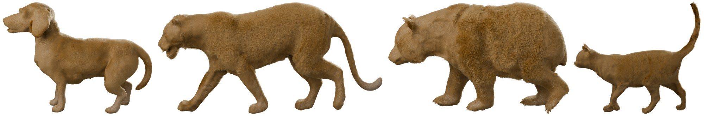
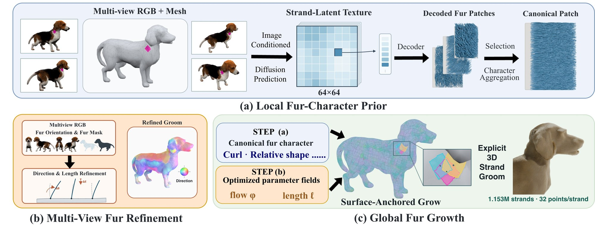
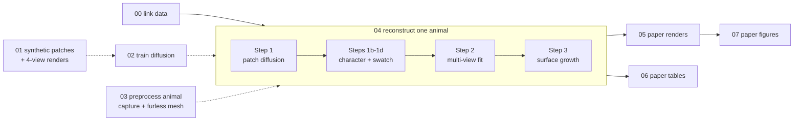

# PatchLocks

**Reconstructing animal fur as individual strands from multi-view images, with one learned patch prior.**



PatchLocks learns a fur prior from **local surface patches** instead of a shared body template,
so the same model works across species with different shapes. An image-conditioned diffusion
model predicts local 3D fur on each patch of a furless body mesh; the predictions are distilled
into a direction-free fur *character*; a screen-space fit recovers per-patch orientation and
relative length from the photos; and surface growth places 1.1–1.2M strands. One model
reconstructs a beagle, a white tiger, a panda and a cat.



## Quick start

```bash
# 1. environment (Python 3.11, CUDA 12.8)
conda create -n patchlocks python=3.11 -y && conda activate patchlocks
pip install torch==2.8.0 torchvision==0.23.0 --index-url https://download.pytorch.org/whl/cu128
pip install -r requirements.txt

# 2. weights and data (layout: data/manifest.txt)
bash pipeline/00_link_data.sh /path/to/PatchLocks_data

# 3. reconstruct the four animals with the paper model, then render them like the paper
bash pipeline/04_reconstruct_animals.sh          # -> outputs/refine_v16/<animal>/grow/surfpack_v2fur.npz
bash pipeline/05_render_paper_views.sh           # -> outputs/renders/refine_v16/
```

## Pipeline

Run the stages in order from the repository root. Stages 1–3 are optional because their outputs
are released. Every stage reads the linked data read-only and writes to `outputs/`.



| Stage | Command | Output | Time |
|---|---|---|---|
| 0 Link weights and data | `bash pipeline/00_link_data.sh DATA_ROOT` | symlinks | seconds |
| 1 Synthetic training data *(optional)* | `bash pipeline/01_synthetic_data.sh` | `outputs/data/` | hours |
| 2 Train the diffusion model *(optional)* | `bash pipeline/02_train_diffusion.sh` | `outputs/train/` | ~30 min |
| 3 Preprocess a new animal *(optional)* | [docs/NEW_ANIMAL.md](docs/NEW_ANIMAL.md) | patch packs, cameras | ~1 h |
| 4 Reconstruct animals | `bash pipeline/04_reconstruct_animals.sh` | `outputs/refine_v16/` | ~15 min / animal |
| 5 Render with the paper's material and cameras | `bash pipeline/05_render_paper_views.sh` | `outputs/renders/` | ~5 min / animal |
| 6 Recompute the paper tables | `bash pipeline/06_evaluate_paper_tables.sh` | `outputs/tables/` | ~1–1.5 h |
| 7 Rebuild the paper figures | `bash pipeline/07_build_paper_figures.sh` | `outputs/figures/` | ~1 min, CPU |

Times are for one NVIDIA RTX PRO 6000. Each script's header documents its inputs, settings and
options; [docs/PIPELINE.md](docs/PIPELINE.md) explains every step of stage 4.

## Reproducibility

This repository is the code that produced the paper, imported verbatim (first commit) and then
made portable; `git diff` against the first commit shows every change. Rerunning it reproduces:

* **diffusion predictions:** bit-identical;
* **grooms:** identical up to GPU float non-determinism in the multi-view fit (same strand counts and roots, 0.02 % median tip displacement);
* **renders:** visually indistinguishable;
* **all 12 script-built paper figures:** byte-identical.

Details, the table-by-table status and known issues are in
[docs/REPRODUCIBILITY.md](docs/REPRODUCIBILITY.md).

## Documentation

| Document | Contents |
|---|---|
| [docs/PIPELINE.md](docs/PIPELINE.md) | stages, the steps inside a reconstruction, determinism |
| [docs/DATA.md](docs/DATA.md) | weights and datasets, sources and licenses, how our data was generated |
| [docs/NEW_ANIMAL.md](docs/NEW_ANIMAL.md) | preprocessing a new animal |
| [docs/REPRODUCIBILITY.md](docs/REPRODUCIBILITY.md) | what was verified and how, known issues |
| [figures/README.md](figures/README.md) | every paper figure → builder → inputs |
| [data/manifest.txt](data/manifest.txt) | every checkpoint and dataset the code expects |

## Repository layout

The layout mirrors the original project because scripts resolve inputs by paths relative to the
repository root.

```
pipeline/                        numbered entry points (start here)
patchlocks/
  v16/                           paper diffusion model: training, inference, Table 1 evaluation
  v14/v14_common.py              multi-view fuser, sampler, train/val split
  deploy/                        whole-animal reconstruction, per-animal recipes, preprocessing, renderers
  experiments/rebuttal_2027/     paper experiments, frozen-test-set manifests, result JSONs
  data_gen/  v11_longfur/        synthetic fur-patch generators and dataset builders
  models/                        strand-codec fine-tuning
  inference/                     single-view baseline (Table 1)
  qa/                            patch renderers
models/ modules/ utils/          strand codec (from DiffLocks) and shared utilities
figures/                         figure builders, verification, draw.io source
docs/                            documentation
data/manifest.txt                every weight and dataset, with size and purpose
```

## Citation

To be added.

## License

To be decided. Third-party components keep their own licenses: the strand codec architecture and
initial weights come from [DiffLocks](https://difflocks.is.tue.mpg.de/); the real-animal data come
from [NeuralFur](https://github.com/Vanessik/NeuralFur) (CC BY-NC-SA 4.0) and
[ARTEMIS](https://github.com/HaiminLuo/Artemis).
